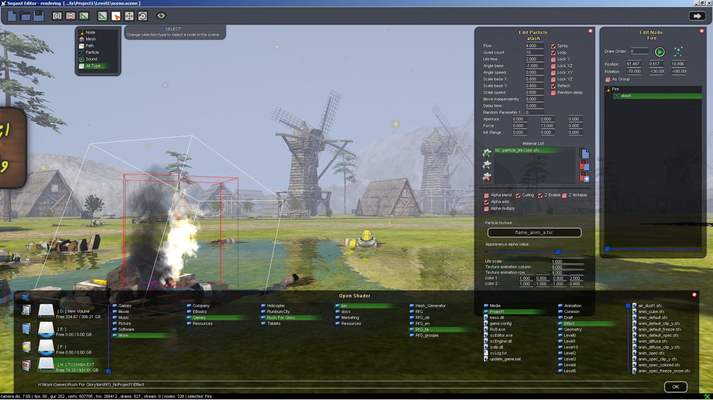
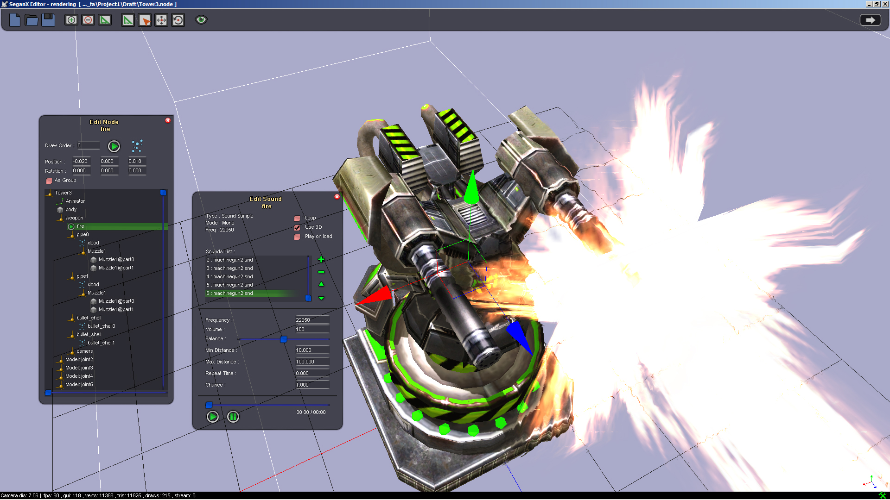
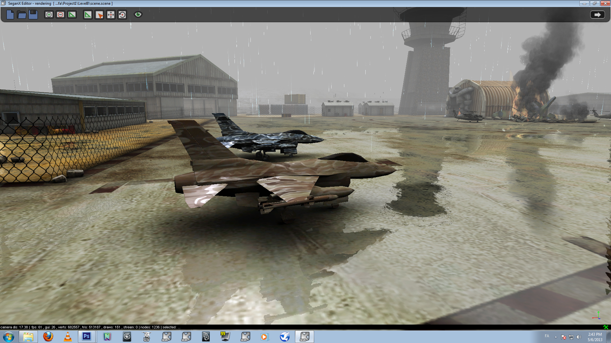
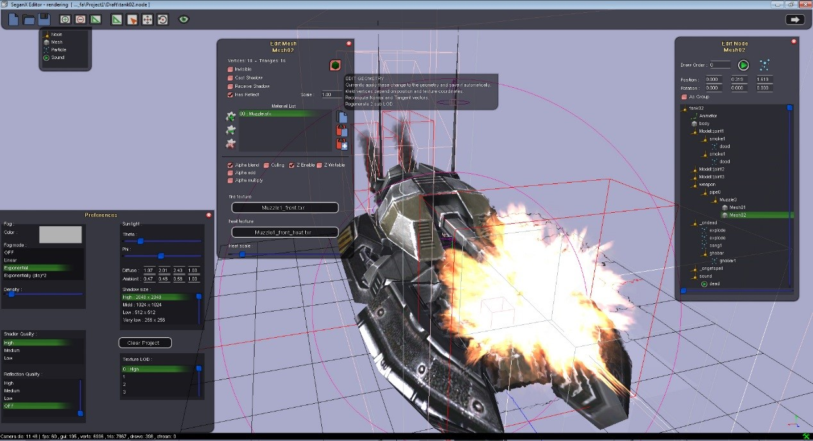
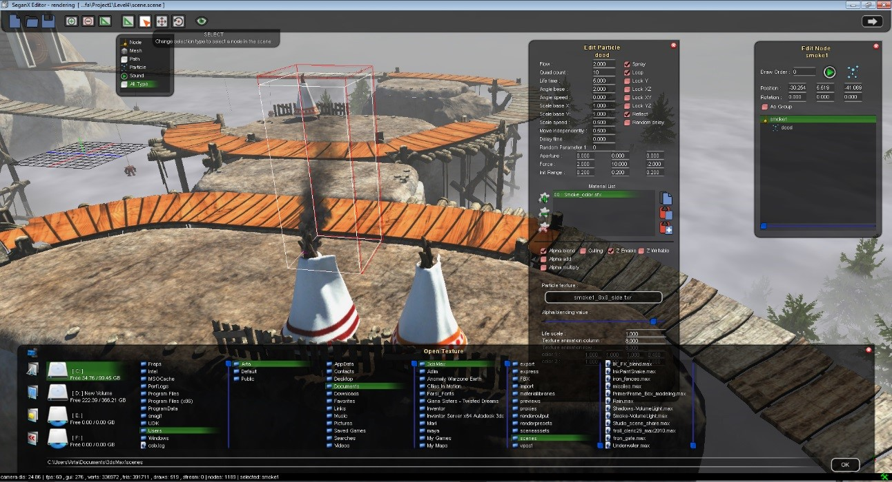

# SeganX Game Engine Discontinued!

Welcome to the SeganX game engine series – the lightweight solution for game development on PCs and portable devices. Our current version introduces a fresh design philosophy, emphasizing ease of use, flexibility, and innovation in game development.

## Features

- **Component-Based Architecture**: Simplify your development process with our modular approach. Easily add, modify, or remove components to suit your game's needs.

- **User-Friendly**: Whether you're a seasoned developer or just starting out, SeganX is built to be accessible. Dive into game development with an engine that's easy to learn and use.

- **Enhanced Gameplay Experience**: Focus on creating immersive and engaging game experiences. Our engine is optimized to handle the intricacies of modern game design, ensuring your players enjoy every moment.

- **Integrated Special Editor**: Experience seamless development with our special editor, which uses the embedded engine UI as a graphical user interface. This intuitive editor provides a direct and immersive way to interact with your game's components and features, streamlining the development process and enhancing productivity.

